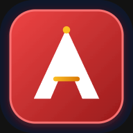

# ALFA University College · Interactive Executive Presentation & Analytics Portal

<div align="center">



**FIB 2074 Introduction to Management · Final Group Project**  
*From 100% Agent Dependency to 65% Direct Digital Enrolment & One Paperless Platform*

[](https://github.com/xumoyun07/alfa-management)
[](https://github.com/xumoyun07/alfa-management)
[](https://github.com/xumoyun07/alfa-management)
[](https://github.com/xumoyun07/alfa-management)
[](https://github.com/xumoyun07/alfa-management)

[🚀 Live Interactive Demo](https://xumoyun07.github.io/alfa-management/) · [📖 Documentation](docs/) · [📊 Financial ROI Model](index.html#calculator) · [🛡️ Speaker Script](index.html#script)

</div>

---

## 📌 Executive Summary

This repository hosts the **Production Release (v4.5)** of the interactive executive presentation, academic theory study system, and financial simulation portal developed for **ALFA University College** (Subang Jaya, Malaysia).

The portal accompanies the academic group project for **FIB 2074 Introduction to Management**, establishing a complete, mathematically reconciled 12-month turnaround strategy:
- **Baseline Challenge**: 100% reliance on third-party recruitment agents (12 master agents, 96 sub-agents) spending **$150,000/year** ($375/student) on 400 new enrolments, paired with 5–7 day paper registration delays.
- **Proposed Strategic Plan**: Shifting to **65% direct digital enrolment** (260 students) via **ALFA OneHub** (unified CRM, ERP, and HRM cloud architecture) alongside a $42,000 transformation budget.
- **Financial Turnaround**: Slashing recruitment spend from **$160,000 to $94,500** ($400.00 → $236.25 blended cost/student), delivering **+$97,500** gross commission savings and **+$55,500 net annual tuition savings**, retaining **90.55%** of $1,000,000 tuition revenue.

---

## 🌟 Key Application Modules

```mermaid
graph TD
    A[ALFA Executive Management Portal] --> B[1. Executive Overview Hub]
    A --> C[2. 17-Slide Presentation Deck]
    A --> D[3. Dynamic ROI Simulator]
    A --> E[4. ALFA OneHub Platform]
    A --> F[5. Theory & Q&A Flashcards]
    A --> G[6. Speaker Script Studio & Super Admin]

    B --> B1[4 Key Figures & Formulas]
    B --> B2[11 Interactive Vector Models Spotlight & Grid]

    C --> C1[7 Team Members / 17 Pages]
    C --> C2[Full Vector SVG Lightbox & Pan/Zoom]
    C --> C3[Desktop Hotkeys & Slide Notes Drawer]

    D --> D1[Real-Time Sliders & 6 Milestone Presets]
    D --> D2[Sensitivity Matrix & CSV Data Export]

    E --> E1[Direct CRM <24h SLA]
    E --> E2[Paperless ERP Registry]
    E --> E3[HRM Direct Staff Bonus Portal]

    F --> F1[Multi-Token Search & Lecture Filters L1-FG]
    F --> F2[Theory Admin Panel & Knowledge Editor]

    G --> G1[3-Tier RBAC Authentication]
    G --> G2[Super Admin Settings & Password Manager]
```



### 1. Executive Overview Hub
- **Executive Scorecard**: Instant inspection of the 4 foundational turnaround metrics (Net Annual Saving `+$55,500`, Direct Enrolment `65%`, Cost per Student `$400.00 → $236.25`, Student Admin Turnaround `<24 hours`). Tap any figure for mathematical assumptions and formulas.
- **11 Interactive Strategy & Economics Models**: Dual-mode vector chart index featuring **Deck Spotlight Mode** and **2-Column Responsive Grid**, complete with category filter chips (`Economics & ROI`, `OneHub & Ops`, `120 Staff`, `POLC & Strategy`).

### 2. 17-Slide Executive Presentation Deck (Desktop Optimized)
- **17 Dedicated Full-Viewport Story Pages**: Tailored for desktop presentation displays and projectors, structured across all 7 team members according to the official Malaysian Higher Education assessment guidelines.
- **Interactive Visualizations**: Every slide features an interactive component (timelines, before/after switches, organograms, process flows, and sensitivity matrices).
- **Full Vector Lightbox**: Click any diagram to inspect high-resolution vector graphics with wheel zoom, drag pan, double-tap zoom, and touch gesture support.
- **Overview Grid (`Esc`)**: Rapid navigation across all 17 slides filtered by team member.
- **Extended Reference Drawer (`D`)**: In-depth academic commentary, data tables, and evidence sources.
- **Mobile Experience Alignment**: On mobile devices, presentation slides are removed in favor of the touch-first **Executive Hub & Management Cockpit** (Hero Metrics, 11-Model Vector Spotlight & Grid, ROI Simulator, OneHub Architecture, Theory Flashcards, Speaker Script), ensuring an optimal, non-cluttered mobile experience.

### 3. Dynamic Financial ROI Simulator
- **Live Financial Cockpit**: Real-time mathematical simulation engine testing student intake (100–1000), tuition rates ($1,500–$5,000), direct enrolment share (0%–100%), and staff bonus levels ($0–$150/student).
- **6 Milestone Presets**: `ALFA Plan · 65%`, `Today Baseline · 0%`, `Q1 · 20%`, `Q2 · 40%`, `Q3 · 55%`, and `Stretch Goal · 85%`.
- **Sensitivity Matrix & CSV Export**: Rate testing table and one-click data export to spreadsheet formats.

### 4. ALFA OneHub Cloud Architecture
- **Interactive Architecture Viewer**:
  - **Direct CRM**: Live lead tracking, turnaround timestamps, and strict `<2-hour` reply SLA.
  - **Registry ERP**: Digital student records, tuition reconciliation, and timetable generation in `<24 hours`.
  - **Staff HRM**: `$50/student` direct staff bonus pool, performance tracking, and recognition workflows.
  - **Agent Network Map**: Visual 3-tier commission chain mapping the 12 master agencies and 96 sub-agents.

### 5. Management Theories & Q&A Flashcards
- **Academic Alignment**:
  - **Lecture 1 (L1)**: POLC Management Functions, Mintzberg’s 3 Roles, and 3 Management Levels.
  - **Lecture 2 (L2)**: Classical, Behavioural (Hawthorne), and Contingency Theories.
  - **Lecture 3 (L3)**: Robbins & Coulter 6 Planning Steps, SMART Goals, and Contingency Scholarship Trigger.
  - **Lecture 4 (L4)**: Authority, Delegation, and Span of Control (re-engineered from 7 to 4–6).
  - **Lecture 5 (L5)**: 6-Step Leading Process, Referent/Expert Power vs. Coercive Power.
  - **Sections F & G (FG)**: 4-Step Control Process (Feedforward, Concurrent, Feedback) and Motivation Models (Herzberg & Maslow).
- **Interactive Multi-Token Search**: Instant real-time filtering across titles, concepts, and ALFA institutional case studies.
- **Theory Admin Mode**: Password-protected knowledgebase editor.

### 6. Speaker Script Studio & Super Admin Settings
- **Role-Based Presentation Mode**: Tailored speaking scripts, timing benchmarks, and stage cues for each of the 7 speakers.
- **Session Persistence**: Authentication persists across page navigation and background browser tab switches.
- **Explicit Security Lock**: Modules remain unlocked until the user explicitly clicks the **Lock** button.
- **Super Admin Settings**: Independent administrative panel enabling module access toggling and in-app password editing for Admin and Presenter roles.

---

## 🛡️ Role-Based Access Control (RBAC) & Credentials

The portal implements an offline client-side security architecture powered by **AES-GCM** encryption and **PBKDF2** key derivation:

| Role | Default Password | Permissions & Capabilities |
|---|---|---|
| **Super Admin** | `lektor07xumoyun` | Full access to all 5 modules, Theory Admin, Speaker Script Studio, and the **Super Admin Settings Modal** with password management. |
| **Admin** | `fashion2026` | Full access to all 5 modules, Theory Admin Panel, and Speaker Script Studio. *(Cannot open Settings modal; password can be changed by Super Admin).* |
| **Presenter** | `tm16112026` | Dedicated access to Speaker Script Studio and presentation cues only. Theory Admin is restricted. *(Password can be changed by Super Admin).* |

> [!NOTE]
> When the Super Admin updates the passwords for the **Admin** (`fashion2026`) or **Presenter** (`tm16112026`) roles inside the Settings modal, changes are saved to browser `localStorage` and take effect immediately. Role privileges are strictly immutable.

---

## ⚙️ Technical Architecture & Quality Assurance

- **100% Self-Contained**: Single core bundle (`index.html`) containing all HTML, CSS, JavaScript, and embedded vector graphics. Zero external CDN dependencies (no React, Vue, jQuery, or Tailwind overhead).
- **Progressive Web App (PWA)**:
  - Cache-first Service Worker (`sw.js`, cache version `v4.5`) ensuring 100% offline capability.
  - Web App Manifest (`manifest.json`) with 5 high-resolution and maskable app icons.
  - Install prompt integration via `#dInstallBtn` (desktop header) and `#mInstallBtn` (mobile corner).
- **Responsive Engineering**: Dual-mode rendering engine with zero horizontal scrollbar overflow:
  - **Desktop Display**: 6 full-feature executive modules, including the full-viewport 17-Slide Presentation Deck with keyboard hotkeys (`←`/`→`, `Space`, `Esc`, `D`, `O`) and drawer notes.
  - **Mobile Touch**: 5 streamlined core modules (`Home`, `ROI`, `OneHub`, `Theory`, `Script`) centered around the Executive Overview Hub & 11-Model Vector Spotlight, engineered cleanly for 360px–430px viewports with zero horizontal clipping.
- **Automated Verification**:
  - `171 / 171` automated vector SVG layout checks passed with zero clipping across 7 responsive viewports.
  - `149 / 149` unique DOM IDs with zero duplicate collisions.
  - `213` inline event handlers verified against `67` custom functions with zero missing definitions.

---

## 📁 Repository File Structure

```text
├── index.html            # Main single-file executive application portal (638 KB)
├── sw.js                 # PWA Service Worker (Cache-First Offline Engine)
├── manifest.json         # Web App Manifest & Application Shortcuts
├── favicon.png           # Browser Favicon
├── icon.svg              # Scalable Vector App Icon
├── _headers              # Security & Caching Headers (Cloudflare / Netlify)
├── vercel.json           # Production Deployment Config (Vercel)
├── .nojekyll             # GitHub Pages Static Bypass
├── .gitignore            # Git exclusion rules (scratch, logs, archives)
├── README.md             # Repository Documentation
├── icons/                # High-resolution PWA Application Icons
│   ├── icon-192.png
│   ├── icon-512.png
│   ├── icon-maskable-192.png
│   ├── icon-maskable-512.png
│   └── icon.svg
├── docs/                 # Academic Project Documentation & Deliverables
│   ├── ALFA_University_College_Final_Group_Project_v4.docx
│   ├── ALFA_University_College_Management_Plan_v4.pptx
│   ├── ALFA_Management_Theory_and_Study_Guide_v4.docx
│   └── ALFA_Presentation_Script_7_Speakers_v4.docx
└── report/               # Automated QA Audit Reports & Visual Verification
    ├── chart_audit.js    # 171-point SVG verification suite
    ├── CHART_AUDIT.md    # Chart quality report
    └── screenshots/      # High-DPI audit captures
```

---

## 🚀 Deployment Guide

### Option 1: Vercel (One-Click)
1. Fork or clone this repository to GitHub.
2. In your [Vercel Dashboard](https://vercel.com/), select **Add New Project** and import `alfa-management`.
3. Keep default settings (`Framework Preset: Other`, `Root Directory: ./`).
4. Click **Deploy**. The included `vercel.json` automatically configures PWA caching headers.

### Option 2: GitHub Pages
1. Go to repository **Settings** → **Pages**.
2. Under **Build and deployment** → **Source**, select `Deploy from a branch`.
3. Choose branch `main` and folder `/ (root)`.
4. Click **Save**. Your site will be published at `https://<username>.github.io/alfa-management/`. The included `.nojekyll` file ensures seamless serving.

### Option 3: Netlify
1. Drag and drop the repository folder into [Netlify Drop](https://app.netlify.com/drop) or connect via GitHub.
2. The included `_headers` file ensures optimal cache-control for `sw.js` and `manifest.json`.

### Option 4: Local Offline Execution
No web server required for basic browsing. Simply double-click `index.html` in any modern web browser, or serve locally with Python/Node:
```bash
# Using Python:
python -m http.server 8080

# Using Node.js:
npx serve .
```

---

## 👥 Academic Credits & Team Allocation

**Course**: FIB 2074 Introduction to Management  
**Institution**: ALFA University College, Subang Jaya, Malaysia  
**Academic Intake**: 2026

| Member | Assessment Section | Primary Focus & Topic |
|---|---|---|
| **Member 1** | Section A (15 Marks) | Introduction to ALFA University College & Executive Business Concept |
| **Member 2** | Section B (10 Marks) | Operational Problem Identification: Agent Dependency & Paperwork Delays |
| **Member 3** | Section C (10 Marks) | Planning Function: 12-Month Strategic Roadmap & $42,000 Budget |
| **Member 4** | Section D (10 Marks) | Organising Function: 120 Staff Structure & Span of Control (4–6) |
| **Member 5** | Section E (10 Marks) | Leading Function: Situational Leadership, Stand-ups & Power Sources |
| **Member 6** | Section F (10 Marks) | Controlling Function: 3 Control Types & SLA Benchmarks (<24h) |
| **Member 7** | Section G (15 Marks) | People & Strategy: Maslow/Herzberg Motivation & Financial Reconciliation |

---

## 📄 License & Academic Integrity

This project is created exclusively for academic evaluation under **ALFA University College**.  
All rights to institutional branding and course materials belong to their respective copyright holders. Educational use and evaluation permitted.
