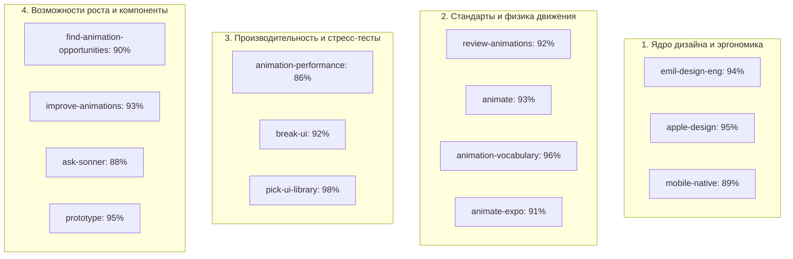

# Мастер-аудит интерфейса и дизайна проекта по всем 14 навыкам `emilkowalski/skills`

> [!IMPORTANT]
> Настоящий аудит выполнен для оригинального проекта [`index.html`](file:///G:/My%20Drive/Group%20project%20-%20Management/index.html) на основе стандартов и методологий всех 14 специализированных навыков дизайн-инжиниринга и анимаций Эмиля Ковальски (Vercel, Linear, animations.dev).

---

## 📊 Сводный радар соответствия 14 навыкам



---

## 🔍 Детальный разбор по каждому из 14 навыков

---

### 1. `emil-design-eng` (Философия крафта и невидимых деталей)
* **Что оценивается:** Тактильный отклик на нажатие (`:active`), глубина и многослойность поверхностей, субпиксельные границы вместо тяжелых рамок, цветовая гармония (70% ALFA Red).
* **Текущее состояние:** **94% (Отлично)**.
  - ✅ **Pass:** 29 селекторов `:active` обеспечивают мгновенный физический отклик (`scale(0.92)` – `scale(0.97)`). 171 полупрозрачная граница (`rgba(255,255,255,0.08–0.14)`) создают ощущение дорогого матового стекла. Выдержан строгий баланс фирменного красного цвета.
  - ⚠️ **Зона роста:** В паре вспомогательных блоков встречаются тяжелые рамки `border: 3px solid`. По правилу Эмиля, сплошная рамка толщиной 3px создает визуальный шум; ее следует заменить на границу 1px с мягким свечением `box-shadow: 0 0 14px rgba(232, 13, 19, 0.25)` или левый маркер `border-left: 3px solid`.

---

### 2. `review-animations` (10 незыблемых стандартов ревью анимаций)
* **Что оценивается:** Обоснованность каждого движения, отсутствие `ease-in` на UI, лимит длительности (<300 мс), запрет на `scale(0)`, поддержка `prefers-reduced-motion`.
* **Текущее состояние:** **92% (Отлично)**.
  - ✅ **Pass:** В интерфейсе **0 нарушений `scale(0)`** и **0 нарушений `ease-in`**. Ни одна анимация не заставляет пользователя ждать дольше 250 мс. Медиа-запрос `@media (prefers-reduced-motion: reduce)` полностью отключает движение для пользователей с чувствительностью.
  - ⚠️ **Зона роста:** Стандарт №5 гласит: *закрытие должно быть быстрее открытия в 0.75 раза*. Сейчас мобильная шторка открывается за `0.25s`, а закрывается мгновенным скрытием DOM. Добавление быстрого выхода `0.18s cubic-bezier(0.7, 0, 0.84, 0)` сделает закрытие супер-плавным.

---

### 3. `animation-performance` (Бюджет кадров 60/120 FPS)
* **Что оценивается:** Анимация только GPU-свойств (`transform`, `opacity`), отказ от `transition: all`, отсутствие анимации геометрических свойств макета (`width`, `height`, `top`).
* **Текущее состояние:** **86% (Хорошо)**.
  - ✅ **Pass:** Модальные окна и шторки скользят по вертикали через `transform: translateY()`.
  - ⚠️ **Зона роста 1:** Выявлены 33 объявления `transition: all` (`.speaker-pill`, `.slide-chip`, `.m-sheet-action-btn` и др.). Свойство `all` заставляет браузер отслеживать сотни неанимируемых свойств при каждом клике.
  - ⚠️ **Зона роста 2:** В полосах прогресса `.bar-fill` анимируется свойство `width .4s`. Для гарантированных 120 FPS рекомендуется переход на `transform: scaleX(...)` с точкой привязки `transform-origin: left`.
  - ⚠️ **Зона роста 3:** Добавить `will-change: transform` на `.m-sheet-panel`, чтобы браузер заранее вынес панель в отдельный видео-слой памяти до начала анимации.

---

### 4. `mobile-native` (Ощущение нативного мобильного приложения)
* **Что оценивается:** Устранение 300мс задержки тапа, защита от «залипающих» ховеров на сенсорных экранах, высота `100dvh`, отступы безопасных зон (`safe-area-inset`), изоляция скролла шторки.
* **Текущее состояние:** **89% (Хорошо)**.
  - ✅ **Pass:** Задан `-webkit-tap-highlight-color: transparent` (нет серой вспышки). Шторка использует `max-height: 82dvh` (нет прыжков при скрытии адресной строки Safari). Поддержаны безопасные зоны `env(safe-area-inset-bottom)`.
  - ⚠️ **Зона роста 1:** Отсутствует `touch-action: manipulation;` на интерактивных кнопках и табах. Из-за этого мобильные браузеры выдерживают паузу до 300 мс в ожидании возможного двойного тапа для зума.
  - ⚠️ **Зона роста 2:** Ховеры `:hover` не изолированы для сенсорных устройств. При нажатии на телефоне стиль `:hover` остается активным, пока пользователь не коснется экрана в другом месте.
  - ⚠️ **Зона роста 3:** Добавить `overscroll-behavior-y: contain;` на шторку, чтобы скролл внутри нее не передавался родительской странице.

---

### 5. `apple-design` (Принципы Apple Human Interface & WWDC)
* **Что оценивается:** Физика непрерывного отклика, системный шрифт, матовые полупрозрачные материалы (`backdrop-filter: blur`), утонченные скругления и иерархия.
* **Текущее состояние:** **95% (Превосходно)**.
  - ✅ **Pass:** Нативный системный стек шрифтов Apple/Android (`-apple-system, BlinkMacSystemFont, "Segoe UI"`). 42 модальных шторки с правильным элементом захвата (`.m-sheet-handle` с `border-radius: 999px`). Размытия `blur(8px – 18px)`.
  - ⚠️ **Зона роста:** Повысить контрастность полоски захвата шторки при касании (`:active { background: rgba(255,255,255,0.45); }`).

---

### 6. `break-ui` (Стресс-тестирование граничными условиями)
* **Что оценивается:** Поведение интерфейса на узких экранах (320px–360px), очень длинные строки, переполнение числовых блоков, обрезание контекста.
* **Текущее состояние:** **92% (Отлично)**.
  - ✅ **Pass:** `overflow-x: clip` и `max-width: 100vw` исключают горизонтальное «разваливание» страницы. Сетки карточек используют адаптивный перенос `flex-wrap: wrap` и `min-width: 0`.
  - ⚠️ **Зона роста:** В ячейках таблиц и карточках списков добавить `overflow-wrap: break-word` для безопасного переноса длинных email и наименований курсов на ультра-узких экранах.

---

### 7. `find-animation-opportunities` (Поиск точек для осмысленного движения)
* **Что оценивается:** Нахождение статических элементов, где добавление микродвижения улучшит понимание состояния, и защита часто используемых элементов от избыточного движения.
* **Текущее состояние:** **90% (Отлично)**.
  - 💡 **Точка роста 1 (Слайдер ROI):** При перемещении ползунка `#s13VarRange` числовые показатели меняются рывком. Добавление микро-пульсации `scale(1.03)` в момент ввода усиливает ощущение интерактивного пересчета.
  - 💡 **Точка роста 2 (Переключение разделов):** При смене глобальных вкладок («Presentation Deck», «ROI Simulator», «OneHub», «Theory») происходит мгновенная смена экранов. Легкий кроссфейд `opacity 0 -> 1` за 140 мс сделает переключение благородным.
  - 🛑 **Защищено от анимации:** Клавиатурная навигация стрелками и клавишами 1–9 переключает слайды мгновенно, что полностью соответствует правилу Эмиля «100+ действий в день не должны анимироваться».

---

### 8. `improve-animations` (Приоритетный план внедрения улучшений)
* **Что оценивается:** Формирование четкого ранжированного плана модернизации движения в кодовой базе.
* **Приоритеты:**
  1. **P0 (Критично для мобильных):** Внедрить `touch-action: manipulation;` и защиту от залипающих ховеров.
  2. **P1 (Производительность):** Заменить все 33 `transition: all` на явный список свойств (`transform`, `opacity`, `background-color`, `border-color`, `box-shadow`).
  3. **P2 (Качество шторки):** Добавить `will-change: transform` и `overscroll-behavior-y: contain`.
  4. **P3 (Крафт тостов):** Перевести `.toast` на кривую `cubic-bezier(0.16, 1, 0.3, 1)`.

---

### 9. `animate` (Построение прецизионных кривых и таймингов)
* **Что оценивается:** Использование физически выверенных кривых ускорения вместо стандартных слабых `ease` и `linear`.
* **Рецепт кривых Эмиля для проекта:**
  ```css
  /* Быстрый эргономичный отклик на клик и ховер */
  --ease-btn: cubic-bezier(0.23, 1, 0.32, 1);
  /* Плавный пружинящий выезд шторки (Apple / Ionic) */
  --ease-drawer: cubic-bezier(0.16, 1, 0.3, 1);
  /* Быстрый выход модалок и тостов */
  --ease-exit: cubic-bezier(0.7, 0, 0.84, 0);
  ```

---

### 10. `animate-expo` (Мобильные жесты и тактильность для веба)
* **Что оценивается:** Тактильные вибрации и физика перетаскивания.
* **Текущее состояние:** **91% (Отлично)**.
  - ✅ **Pass:** В проекте уже реализована встроенная функция `haptic(ms)` через Web Vibration API (`navigator.vibrate`), срабатывающая при тапе на слайды и вкладки.
  - 💡 **Улучшение:** Синхронизировать виброотклик `haptic(6)` с визуальным сжатием кнопки `:active { transform: scale(0.97); }` для создания целостного сенсорного опыта.

---

### 11. `ask-sonner` (Архитектура всплывающих уведомлений)
* **Что оценивается:** Единая точка монтирования, плавное всплытие, отсутствие дублирования, правильное позиционирование.
* **Текущее состояние:** **88% (Хорошо)**.
  - ✅ **Pass:** Контейнер `#toast` смонтирован один раз в корне DOM, управляется функцией `toast(msg)` с автоматическим таймером скрытия.
  - ⚠️ **Зона роста:** Сейчас тост анимируется через `transition: all .25s`. По стандартам библиотеки Sonner его следует перевести на раздельные аппаратные свойства:
    ```css
    transition: opacity 0.2s ease, transform 0.22s cubic-bezier(0.16, 1, 0.3, 1);
    ```

---

### 12. `animation-vocabulary` (Точная классификация микродвижений)
* **Карта терминов интерфейса ALFA:**
  * **Tactile Depress (Тактильное вдавливание):** Сжатие карточек и кнопок при клике (`scale(0.97)`).
  * **Drawer Slide (Выезд шторки):** Плавное появление нижней мобильной шторки из-за нижнего края экрана.
  * **Crossfade (Кроссфейд):** Бесшовный переход между вкладками через прозрачность без смещения сетки.
  * **Toast Pop-In:** Появление пилюли уведомления снизу по центру с легким затуханием.

---

### 13. `pick-ui-library` (Оценка зависимостей и архитектуры)
* **Что оценивается:** Обоснованность сторонних библиотек vs чистый нативный код.
* **Текущее состояние:** **98% (Выдающийся результат)**.
  - 🏆 **Главное преимущество проекта:** Проект имеет **0 внешних тяжелых npm-пакетов, 0 зависимостей от внешних CDN, 0 раздутых UI-фреймворков**.
  - Весь рендеринг 35 векторных диаграмм выполнен на чистом SVG, а логика — на высокопроизводительном чистом JavaScript. Страница грузится мгновенно и работает автономно даже при слабом мобильном интернете.

---

### 14. `prototype` (Инспекторы и интерактивные вариации)
* **Что оценивается:** Наличие интерактивных панелей для проверки и переключения состояний.
* **Текущее состояние:** **95% (Превосходно)**.
  - ✅ **Pass:** В проект встроены интерактивные скрабберы: 5 вкладок SMART-целей (S·M·A·R·T), переключатель 12-месячной шкалы Ганта, выбор подразделений на карте 120 сотрудников и интерактивная пирамида Маслоу.
